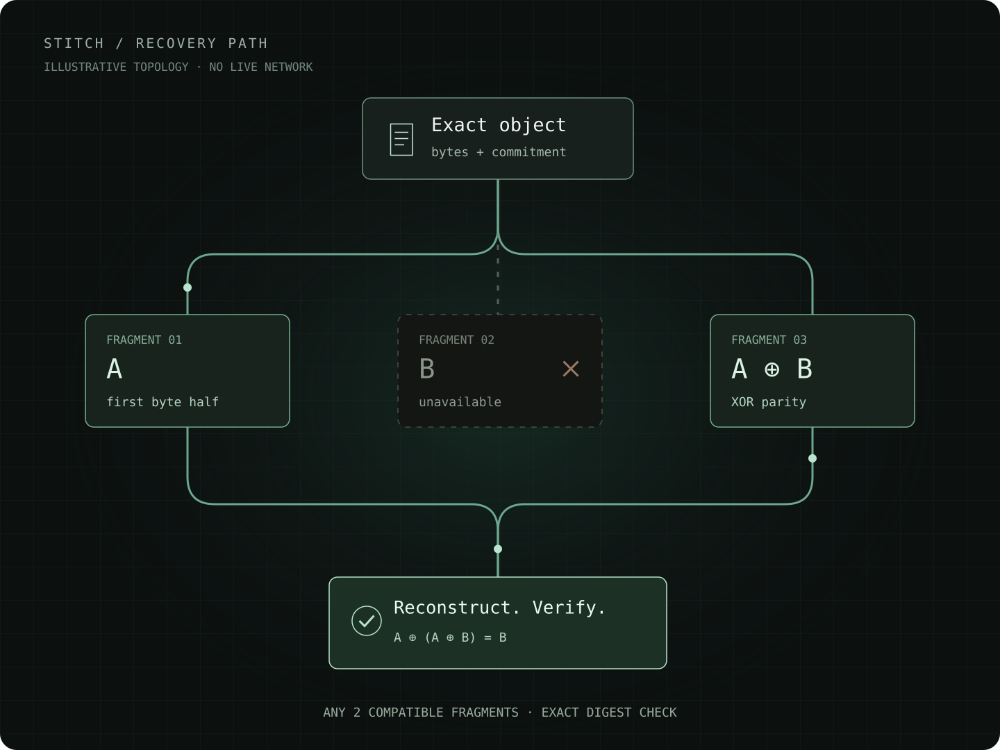

# Stitch

Recover exact objects and resume deterministic computation while the available peers change.

Stitch retains its five layers: object/ring operations, scheduling, storage, compute, and transport. A Prism/LexLean model defines the state and acceptance rules across those layers. The browser applies model-derived admission predicates and independently checks bytes and execution before accepting them.

## Start here

Stitch is a browser-based experiment in recovering exact data and continuing deterministic work while peers change. It combines five layers: identity and operations, scheduling, storage, compute, and transport. It does not turn internet routers into storage or guarantee survival after every copy is lost.



### Recover an object

1. **Commit to the bytes.** A full SHA-256 commitment identifies the object. Its filename is only a label.
2. **Distribute compatible fragments.** Stitch creates two byte halves and an XOR parity fragment. A request to store one is not a checked receipt from a holder.
3. **Recover and verify.** Any two distinct, compatible fragments can reconstruct the object. Stitch checks their commitments and the reconstructed bytes before accepting the result. Enough information must remain reachable.

### Continue a pure job

A checkpoint carries the identified program, input and execution state. Stitch replays that state before continuing, so a plausible-looking but impossible checkpoint is refused. This applies to deterministic ring programs, not arbitrary Linux VM effects. Partitions may duplicate pure computation.

### Choose your route

- **[Try it in the browser](https://syntra-labs.github.io/stitch/):** change a message, withhold a fragment or alter a byte in a local example. Then open the live operator console if you want to use the network.
- **[Understand the protocol](docs/prism-model.md):** read the object, custody, pointer, computation and resource contracts, with their assumptions and nonclaims.
- **[Inspect the product model](app/src/Product/):** follow the typed source and the source-derived facet inventory on the site. Inventory coverage is not proof acceptance.
- **[Run locally](#run-and-test):** install dependencies, serve the repository and run its checks.

The local example uses Stitch's actual object/fragment verifier without joining a mesh or sending its text. Withholding a fragment models unavailable information, not a real peer failure. The live console has separate opt-ins for public signaling and public object relay. Publishing sufficient fragments reveals their content.

The [reader experience contract](docs/reader-experience.md) documents the resolution-independent illustration, local example, accessibility, bounded inputs and test coverage. Implementation details and exact evidence boundaries follow below.

## What changed

- **Objects have full cryptographic commitments.** Canonical manifests bind raw encoding, byte lengths, indexed XOR fragments and every required dependency. Legacy FNV addresses remain in regression/conformance simulations.
- **Placement is explicit.** Requested transfers are not stored copies. Acknowledgments bind checked fragment bytes to a request and holder. Selected retained objects can be repaired as peers join, leave or renew leases. Only fresh, checked receipts activate replacements; uncertain and superseded copies stay accounted until exact release confirmation. Committed placement and expiry remain separate observations. Different peer IDs do not prove independent failure domains.
- **Jobs carry their program and input.** Every checkpoint is digest-checked and semantically replayed through model-derived ring operations. A well-formed but impossible state is refused. Versioned programs include full-width modular POW and width-tracked byte CONCAT with explicit capacity/work admission. This does not certify arbitrary Linux VM effects.
- **Pointers have a single-writer contract.** A separately pinned Ed25519 authority, full object root, exact revision/predecessor and validity interval are required. Observer-local admission is not consensus.
- **Policies propose; admission enforces limits.** Multidimensional budgets reserve before effects. Ambiguous effects remain charged. The live refresh scheduler uses elapsed monotonic time and enforces its own cap.
- **Host failures have explicit recovery paths.** Mesh generations reject stale callbacks, DNS publication reconciles unknown writes before another mutation, and failed VM startup can be explicitly retried.
- **The operator interface follows modeled journeys.** Relevant controls, persistent labels and local results appear for the current journey. Restarted publication and every retained VM command have explicit reconciliation paths; shell output has a text view.
- **Internet formats are implemented at the byte boundary.** JCS input/encoding, DNS-message DoH and bounded ntfy framing replace the earlier partial formats. Concrete interoperability tests remain distinct from browser/provider qualification.
- **The public relay is opt-in.** Publishing sufficient fragments or a checkpoint discloses its content. A channel name is not a privacy control.

Origin-local signing authority, explicitly accepted exact trust anchors and publication intent can be restored after reload. [Browser authority controls](docs/browser-authority.md) provide explicit local key rotation/revocation, independently confirmed anchor migration and conservative storage/journal care. This is not a private-key backup, cross-device authority or protection against origin storage loss.

See the [operator journeys](docs/operator-experience.md), [lifecycle bindings](docs/lifecycle-effects.md), [JCS codec](docs/canonical-json.md), [DNS client](docs/dns-client.md), and [relay framing](docs/relay-framing.md).

Read the [model contract and evidence boundaries](docs/prism-model.md), the [product projection and host contracts](docs/product-projection.md), and the [vendor provenance findings](docs/vendor-provenance.md). [Historical benchmarks](docs/legacy-benchmarks.md) remain available with their limitations. The existing [falsification contract](CONTRACT.json) is retained rather than relabeling simulation as network proof.

## Run and test

Node.js 22 or later:

```sh
npm ci --ignore-scripts
npm test
python3 scripts/verify-custody.py
make serve
```

Open `http://localhost:8080`. Join a mesh to exchange data with peers. Enable the public relay only for intentionally public demonstration data. Fewer than three eligible remote peers means partial placement, not fabricated redundancy.

The original Rust UOR conformance check is `cargo test --locked`. Both the Node/Python runtime checks and Rust conformance passed in [the initial fork CI run](https://github.com/afflom/stitch/actions/runs/42797265770); that historical formal SDK stage did not pass. The historical 25-module checkpoint passed pinned LexLean/Lean/leanchecker/axiom verification, recorded in [the retained exact-source summary](product/source-verification.json) and [actual verifier attestation](product/source-attestation.json). Those records do not verify the newly expanded facet sources, which are pending an actual SDK verification refresh. Native Prism artifact acceptance also remains pending. [Actual Chromium qualification](https://github.com/afflom/stitch/actions/runs/42909486101/job/130156053948) passed seven scenarios on `2f1fde8`, including authenticated WebRTC payload/recovery, browser authority persistence and real guest shell/stop/destroy. This evidence does not qualify other browsers, physical NAT topologies or a replacement guest. This is still an unqualified development checkpoint. `make test` runs Node and Rust checks. The default JavaScript suite includes in-process transports and real bundled-v86 guest execution. Dedicated hosted Chromium scenarios exercise native browser behavior; neither substitutes for physical WebRTC/NAT trials.

## Model and verification

- `app/src/Stitch/`: typed domain models and theorem obligations.
- `app/src/Product/`: component/flow, capability, deployment and dependency contracts plus the expanded product facets. See [complete Prism coverage and evidence boundaries](docs/complete-prism.md) and the [source-derived facet catalog](product/facets.json); catalog coverage is not verification acceptance.
- `product/contracts.json`: source-bound project-owned contract/asset inventory, not a certificate.
- `app/language/`: versioned project vocabulary using LexLean extensibility.
- `src/layer1-uor/generated-model.js`: pure behavior extracted from the model with exact source binding. It is an application adapter, not a replacement Prism compiler or proof certificate.
- `scripts/check-model.mjs`: validates/regenerates the adapter and detects drift.
- `prismpm.lock`, `standards.lock`: exact SDK/standards pins from the official Prism template.
- `.github/workflows/prism.yml`: runtime conformance and SDK model verification on the submitted revision.

```sh
node scripts/check-model.mjs
sh scripts/check-model-sdk.sh
```

The second command requires the pinned SDK environment. It must run real LexLean/Lean and PrismPM gates; extraction or runtime tests alone do not establish that theorems compiled. No externally hosted verifier is required. Formal acceptance is reported only from an actual successful SDK run. See the [native build diagnosis and passing-project comparison](docs/native-build-diagnosis.md) for the reproduced compiler issue; no native gate was replaced or weakened.

### Retain source evidence

After the actual pinned verification succeeds, set `VERIFIED_DIR` to the exact current run's directory under `app/.lexlean/verified/`, then retain its original records:

```sh
node scripts/retain-source-evidence.mjs "$VERIFIED_DIR/attestation.json" "$VERIFIED_DIR/build-manifest.json"
node scripts/check-source-evidence.mjs
```

The helper preserves both input files byte-for-byte and derives `product/source-verification.json` from their records and current inputs. It validates source and lexicon digests, workspace coverage, proof results and pinned tool identities before replacing retained files. The summary is replaced last, so an interrupted multi-file replacement fails the consistency check rather than claiming success. Use only the actual verifier's emitted records: this is retention, not a verifier or a way to authenticate arbitrary JSON. Native Prism acceptance and its artifacts remain separate; capturing the current `app/prism.toml` and `app/prismpm.toml` for later freshness checks does not certify them.

## Nonclaims

SHA-256 and Ed25519 establish integrity and signature validity under their security assumptions, not retention or honest peer identity. DNS is discovery, not globally ordered state. The browser VM, STUN, WebRTC, DNS, signaling, relay availability and clocks remain modeled host boundaries.

This implementation does not claim private relay storage, persistence after total information loss, exclusive job ownership during partitions, exactly-once effects, multi-writer consistency, optimal scheduling, or storage inside internet routers. New encodings, policies and transports must preserve admission obligations and disclose dependencies.

## License

Project source: MIT © [Syntra Labs](https://github.com/Syntra-Labs). Bundled third-party assets retain their respective licenses; see the [provenance and packaging status](docs/vendor-provenance.md) before redistribution.
